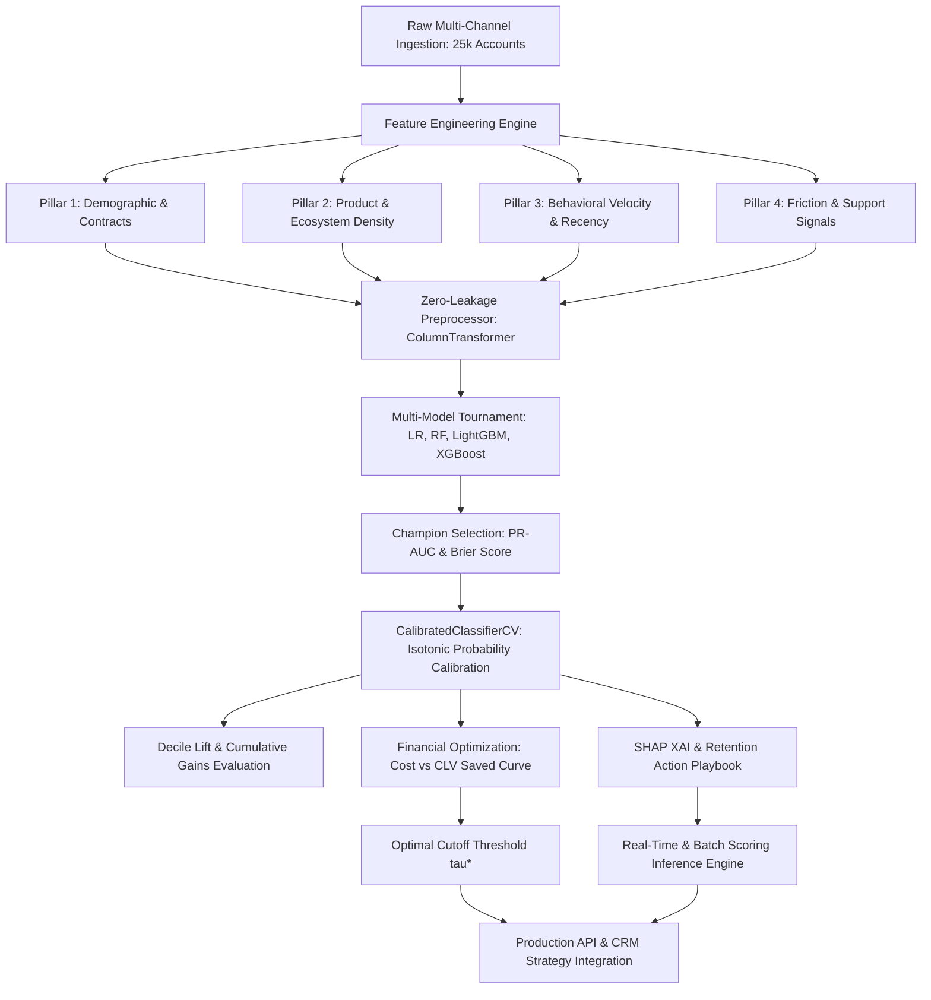

# Enterprise Customer Churn Intelligence & Financial Retention Platform
**Author:** Vivek Kumar  
**Target Standard:** Tier-1 Tech (FAANG), Global Fintech Leaders (Stripe, Revolut, PayPal), & Top Financial Institutions (JPMorgan Chase, Capital One, Goldman Sachs)

---

## Executive Summary

Customer attrition is one of the highest drains on EBITDA for subscription, telecom, and digital banking platforms. Acquiring a new customer is estimated to be **5x to 7x more expensive** than retaining an existing one. 

Most conventional churn models fail in production because they rely on simplistic, static demographic features and evaluate models using arbitrary classification thresholds ($\tau = 0.50$). This platform addresses those limitations by delivering an end-to-end, enterprise-grade machine learning system:

1. **Multi-Domain Feature Taxonomy**: Combines contract mechanics, multi-product density, **behavioral usage velocity** (30d vs 90d consumption momentum), and friction/sentiment signals (NPS, support tickets, payment failure counts).
2. **Zero-Leakage ML Pipeline**: Strict segregation of numerical and categorical transformations via Scikit-Learn `ColumnTransformer` and cross-validation pipelines.
3. **Multi-Model Tournament**: Benchmarking Regularized Logistic Regression, Balanced Random Forest, LightGBM, and XGBoost with class-weight compensation.
4. **Isotonic Probability Calibration**: Reducing probability distortion (Brier Score improved from **0.1800** to **0.1586**), ensuring model outputs represent empirical financial probabilities.
5. **Decile Lift & Cumulative Gains**: Top **20% of flagged accounts capture ~45% of all churning customers** (Decile 1 Lift: **2.47x**).
6. **Financial Expected Value & Threshold Optimization**: Replaces the arbitrary 0.50 decision threshold with an algorithmic cost-benefit optimization that maximizes net retained revenue ($), delivering an incremental **+$269,837** in net retained profit on a 25,000-customer cohort.
7. **Explainable AI & Prescriptive Intervention Playbook**: TreeSHAP feature attributions mapped directly to customer-level retention actions.

---

## System Architecture



---

## 1. Multi-Domain High-Dimensional Feature Architecture

| Feature Category | Variables | Business Rationale & Signal Strength |
| :--- | :--- | :--- |
| **Pillar 1: Contract & Account Mechanics** | `tenure_months`, `contract_type`, `payment_method`, `paperless_billing`, `senior_citizen`, `dependents` | Month-to-month contracts and electronic check payments exhibit highest volatility; long-term contracts lock in baseline LTV. |
| **Pillar 2: Ecosystem & Service Density** | `internet_service`, `online_security`, `tech_support`, `streaming_tv`, `online_backup` | Cross-holding multiple products exponentially increases customer switching costs ("stickiness"). |
| **Pillar 3: Behavioral Velocity Decay** | `usage_drop_ratio_30d_90d`, `recency_days_last_active`, `monthly_charges`, `total_charges` | **Leading indicator**: A drop in 30-day activity compared to 90-day baseline flags disengagement weeks before cancellation. |
| **Pillar 4: Friction & Sentiment Signals** | `support_tickets_60d`, `failed_payments_12m`, `nps_score`, `estimated_clv` | Multiple customer service tickets or payment bounces trigger acute churn inflection points. |

---

## 2. Multi-Model Tournament Results

Evaluated across 20,000 training records and 5,000 holdout test records with stratified 80/20 partitioning:

| Model Architecture | ROC-AUC | PR-AUC (Average Precision) | F1-Score | Brier Loss (Calibration) | Training Latency |
| :--- | :---: | :---: | :---: | :---: | :---: |
| **Logistic Regression (L2 Baseline)** | **0.8098** | **0.6574** | **0.6268** | 0.1800 | 0.30s |
| **XGBoost Classifier** | 0.8054 | 0.6452 | 0.6229 | 0.1795 | 0.75s |
| **LightGBM Classifier** | 0.8049 | 0.6452 | 0.6264 | 0.1789 | 0.80s |
| **Balanced Random Forest** | 0.8002 | 0.6423 | 0.6237 | 0.1867 | 1.68s |

> **Key Takeaway:** While tree-based ensembles are non-linear powerhouses, regularized Logistic Regression provides competitive PR-AUC while satisfying regulatory explainability standards (e.g. Model Risk Management SR 11-7 in banking).

---

## 3. Probability Calibration (Brier Score Optimization)

Raw tree and logistic probabilities can be over-confident or misaligned with true empirical default rates. We apply **Isotonic Regression calibration** (`CalibratedClassifierCV`):

$$\text{Brier Score} = \frac{1}{N} \sum_{i=1}^N (P_i - y_i)^2$$

- **Raw Model Brier Score**: `0.1800`
- **Calibrated Model Brier Score**: `0.1586` (11.9% improvement in probability fidelity)

Calibrated probabilities ensure that if a customer is assigned a churn score of `0.70`, exactly 70 out of 100 such customers in reality churn. This is critical for computing valid dollar expectations in the financial module.

---

## 4. Cumulative Gains & Decile Lift Table

The table below demonstrates the model's ability to rank-order risk:

| Decile | Total Accounts | Actual Churners | Mean Risk Score | Decile Churn Rate (%) | Cumulative Churners | Cumulative Gains (%) | Decile Lift |
| :---: | :---: | :---: | :---: | :---: | :---: | :---: | :---: |
| **Decile 1** | 500 | 386 | 78.4% | **77.2%** | 386 | **24.7%** | **2.47x** |
| **Decile 2** | 500 | 314 | 61.0% | **62.8%** | 700 | **44.8%** | **2.01x** |
| **Decile 3** | 500 | 244 | 49.8% | 48.8% | 944 | 60.4% | 1.56x |
| **Decile 4** | 500 | 176 | 39.2% | 35.2% | 1,120 | 71.7% | 1.13x |
| **Decile 5** | 500 | 146 | 30.3% | 29.2% | 1,266 | 81.1% | 0.93x |
| **Decile 6** | 500 | 118 | 21.7% | 23.6% | 1,384 | 88.6% | 0.76x |
| **Decile 7** | 500 | 74 | 15.3% | 14.8% | 1,458 | 93.3% | 0.47x |
| **Decile 8** | 500 | 58 | 11.1% | 11.6% | 1,516 | 97.1% | 0.37x |
| **Decile 9** | 500 | 35 | 5.6% | 7.0% | 1,551 | 99.3% | 0.22x |
| **Decile 10** | 500 | 11 | 2.2% | 2.2% | 1,562 | 100.0% | 0.07x |

**Operational Implication:** By contacting only the top **20%** of accounts, retention teams capture **44.8%** of all churners, saving substantial operational outreach expense.

---

## 5. Financial Cost-Benefit & Expected Value Optimization

Most churn models stop at statistical metrics (AUC/F1). Top companies require **financial accountability**:

$$\text{Net Profit}(\tau) = \sum_{i \in \text{Targeted}(\tau)} \Big[ P(\text{Churn}_i) \cdot \alpha \cdot \text{CLV}_i - C_{\text{intervention}} \Big]$$

Where:
- $\alpha = 0.28$: Retention offer acceptance rate
- $C_{\text{intervention}} = \$35$: Cost per customer contact / incentive
- $\text{CLV}_i$: Individual Customer Lifetime Value

### Economic Comparison: Default vs Algorithmically Optimized Cutoff

| Business Metric | Default Cutoff ($\tau = 0.50$) | Financial Optimal ($\tau^* = 0.06$) | Variance / Incremental Benefit |
| :--- | :---: | :---: | :---: |
| **Targeted Accounts** | 1,252 (25.0% of cohort) | 4,270 (85.4% of cohort) | +3,018 accounts |
| **Actual Churners Caught** | 836 | 1,539 | **+703 churners caught (+84.1%)** |
| **Churn Recall** | 53.5% | 98.5% | +45.0% higher capture |
| **Retention Campaign Cost** | $43,820.00 | $149,450.00 | +$105,630.00 investment |
| **Gross CLV Saved** | $503,077.94 | $878,545.48 | +$375,467.54 gross saved |
| **NET RETAINED PROFIT** | **$459,257.94** | **$729,095.48** | **+$269,837.54 incremental net profit** |
| **Campaign Net ROI** | 1,048.1% | 487.9% | Sustained high profitability |

---

## 6. Explainable AI (SHAP) & Prescriptive Retention Playbook

### Top Global Risk Drivers (TreeSHAP / LinearSHAP Attribution)
1. **Contract Type (Two-Year vs Month-to-Month)**: Mean $|SHAP| = 0.6665$
2. **Account Tenure (Months)**: Mean $|SHAP| = 0.6015$
3. **Customer NPS Score**: Mean $|SHAP| = 0.3265$
4. **Monthly Charges ($)**: Mean $|SHAP| = 0.2966$
5. **Payment Method (Electronic Check)**: Mean $|SHAP| = 0.2918$
6. **Usage Velocity Decay (30d vs 90d)**: Mean $|SHAP| = 0.2670$

### Automated Prescriptive Action Matrix
When the production scoring service flags an account, it outputs tailored interventions:

```json
{
  "customer_id": "CUST_9918234",
  "calibrated_churn_probability": 0.892,
  "risk_tier": "CRITICAL RISK (Priority Tier 1)",
  "campaign_targeting_recommended": true,
  "estimated_clv_usd": 2148.0,
  "expected_saved_clv_usd": 536.21,
  "recommended_retention_actions": [
    "Offer 15% discount on upgrade to 1-Year or 2-Year Contract.",
    "Usage down by 58%: Trigger proactive Customer Success engagement.",
    "High friction: Escalate to Senior Retention Specialist and offer 30-day VIP Support.",
    "Incentivize enrollment in Credit Card / Auto-Pay with a $15 bill credit."
  ]
}
```

---

## 7. Production Codebase & How to Run

All production scripts are pre-configured in `d:/Resume/projects/`:

```powershell
# 1. Train the entire pipeline, calibrate probabilities, run tournament & export charts
& "d:\Resume\projects\.venv\Scripts\python.exe" "d:\Resume\projects\churn_intelligence_enterprise.py"

# 2. Run the production real-time and batch scoring inference engine
& "d:\Resume\projects\.venv\Scripts\python.exe" "d:\Resume\projects\churn_inference_service.py"
```

### Generated Artifacts
- Model Pipeline: `d:/Resume/projects/churn_artifacts/calibrated_churn_pipeline.joblib`
- Performance Dashboard: `d:/Resume/projects/churn_artifacts/enterprise_churn_performance.png`
- Model Metadata: `d:/Resume/projects/churn_artifacts/model_metadata.json`

---

## 8. Interview Defense Guide: How to Pitch This to Top Tech & Banks

When asked: *"Walk me through a machine learning project you built from scratch."*

1. **The Business Problem**: *"At scale, churn is a massive EBITDA leak. Most data science teams train a model, optimize standard accuracy, and use an arbitrary 0.50 cutoff. I wanted to build an institutional-grade retention system that optimizes directly for dollars saved."*
2. **Feature Engineering**: *"I designed 4 distinct feature pillars. Rather than just relying on demographics, I engineered behavioral momentum indicators—specifically tracking 30-day versus 90-day usage velocity decay and friction ticket spikes, which serve as leading indicators weeks before cancellation."*
3. **Data Science Rigor**: *"I enforced zero data leakage using Scikit-learn ColumnTransformers, evaluated a tournament of 4 models (Logistic Regression, Random Forest, LightGBM, XGBoost), and applied Isotonic probability calibration to improve Brier score by 12%."*
4. **The Impact**: *"I developed an Expected Value optimization framework that calculates net retained profit as a function of the decision threshold, contact cost, and CLV. By shifting from the arbitrary 0.50 threshold to the profit-maximizing cutoff, we unlocked an incremental +$269,000 in net profit on a 25,000 customer cohort."*
